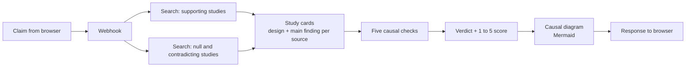

# Causal Claim Auditor

**Is it cause and effect, or just a link?**

Type a claim like *"coffee reduces the risk of depression"* and the tool searches the literature, reads each study's design, works through five causal checks, and returns a 1 to 5 score with a causal diagram.

**Live demo:** https://dag.omid.consulting (3 free audits per visitor)


> Prototype. Verdicts can be wrong. Not medical or professional advice.

---

## How it works



1. **Two searches.** One looks for evidence supporting the claim, a separate one looks for null and contradicting findings.
2. **Study cards.** Each source is reduced to a structured card: study design and main finding.
3. **Causal checks.** The evidence is worked through five checks (below).
4. **Verdict.** A 1 to 5 score plus a short explanation.
5. **Diagram.** A directed acyclic graph (DAG) of the exposure, outcome, and key confounders, mediators, or colliders, rendered with Mermaid.

## The five checks

| Check | Question it asks |
|---|---|
| Design ceiling | What is the strongest study design available, and how much causal weight can that design carry? |
| Confounding | Could a third factor drive both the exposure and the outcome? |
| Mediators and colliders | Are the analyses adjusting for the right variables, or conditioning on something that creates a false association? |
| Consistency | Do findings agree across studies, populations, and designs? |
| Temporality | Does the exposure clearly come before the outcome? |

## Scoring

<!-- TODO: make this table match the rubric in your verdict prompt exactly -->

| Score | Meaning |
|---|---|
| 1 | No credible evidence of a causal effect |
| 2 | Association only, with serious unresolved problems |
| 3 | Mixed or moderate evidence |
| 4 | Strong evidence with minor gaps |
| 5 | Causal effect well established |

## The design decision that mattered most

The first version ran a single search. It mostly found studies that agreed with the claim, because that is what a search for the claim returns, and it scored too confidently as a result.

Adding a **second, separate search for null and contradicting evidence** made verdicts far more balanced. It is a small change in the pipeline and a large change in behaviour: the tool now has to weigh evidence against the claim instead of only collecting evidence for it.

More in [docs/design-decisions.md](docs/design-decisions.md).

## Stack

- **Orchestration:** n8n (self-hosted)
- **LLM:** GPT-5-mini
- **Search:** Tavily
- **Diagram:** Mermaid
- **Hosting:** DigitalOcean droplet, Ubuntu 24.04, Docker Compose
- **Web server / TLS:** Caddy (automatic HTTPS), custom build with the rate-limit plugin

## Cost and usage controls

The demo is free to try, so it is built to stay cheap and hard to abuse:

- **3 audits per visitor**, enforced in Caddy by IP address
- **70 audits per day** across all visitors, also enforced in Caddy
- **Request size limit** of 2 KB at the proxy, and a 5 to 200 character claim length check in the workflow
- **Result cache** in the workflow: repeated claims (ignoring case and punctuation) are answered from cache for 30 days, so they cost nothing
- **Hard monthly spend limit** on the LLM provider, with auto-reload off

The n8n editor is not exposed publicly. Caddy serves the front end and proxies only the webhook path; the editor is reached over an SSH tunnel. See [docs/architecture.md](docs/architecture.md).

## Limitations

The tool reads what search returns, and it inherits the errors of LLM extraction and judgement. See [docs/limitations.md](docs/limitations.md) for known failure modes, and [docs/examples.md](docs/examples.md) for worked examples, including ones it gets wrong.

## Run it yourself

1. Clone this repo onto a server with Docker and Docker Compose.
2. Replace `dag.omid.consulting` with your own domain in `Caddyfile` and `docker-compose.yml`.
3. Point a DNS A record for your domain at the server.
4. Put the front end in `site/` (see [site/README.md](site/README.md)).
5. `docker compose up -d`
6. Open the n8n editor through an SSH tunnel:
   `ssh -L 5678:localhost:5678 user@your-server`, then visit `http://localhost:5678`
7. Import `workflow/causal-audit.json`, add your OpenAI and Tavily credentials in n8n, and activate the workflow.

Details in [workflow/README.md](workflow/README.md).

## Repository layout

```
.
├── README.md
├── docker-compose.yml
├── Caddyfile
├── Dockerfile       Caddy built with the rate-limit plugin
├── site/            front end (static HTML)
├── workflow/        n8n workflow export
├── docs/            architecture, design decisions, limitations, examples
└── assets/          screenshots
```

## Roadmap

- Swap OpenAI for a local model (Qwen via LM Studio) over a private Tailscale tunnel, so inference runs on local hardware without exposing it publicly
- A small evaluation set of claims with expert-agreed verdicts

## Author

Omid Gheysar, PhD · Applied Scientist (ML / LLM systems, causal inference, epidemiological modelling)
[omid.consulting](https://omid.consulting)

## License

MIT, see [LICENSE](LICENSE).
