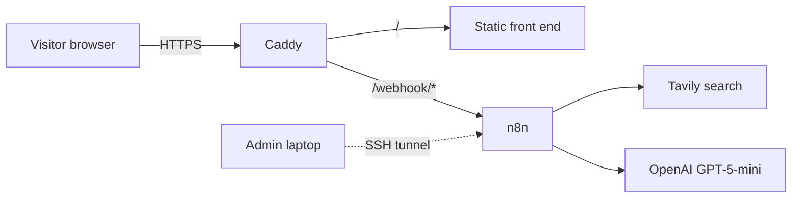

# Architecture

## Request flow

- **Caddy** is the only public service. It terminates TLS (certificates are automatic), serves the static front end at the site root, and proxies only `/webhook/*` to n8n.
- **n8n** is bound to `127.0.0.1` on the host, so it is not reachable from the internet directly. The editor is reached through an SSH tunnel.
- **Secrets** (OpenAI and Tavily keys) live in n8n's encrypted credential store, not in the workflow file or the repo.

## Pipeline stages

| Stage | What happens |
|---|---|
| Webhook | Receives the claim from the front end (rate limits already applied by Caddy) |
| Check cache | Validates claim length; returns a cached verdict if one exists |
| Supporting search | Tavily query for studies that support the claim |
| Disconfirming search | Separate Tavily query for null and contradicting findings |
| Study cards | The LLM extracts a structured card per source: design, main finding |
| Causal checks | The LLM works through the five checks against the cards |
| Verdict | Score from 1 to 5 plus explanation |
| Diagram | A Code node builds Mermaid DAG syntax from the verdict |
| Respond | JSON result returned to the browser |

## Where the limits live

| Control | Where | Detail |
|---|---|---|
| Per-visitor cap | Caddy `rate_limit` | 3 requests per IP address per year |
| Global cap | Caddy `rate_limit` | 70 requests per day across all visitors |
| Request size | Caddy `request_body` | 2 KB maximum |
| Claim length | n8n "Check cache" node | 5 to 200 characters, otherwise "Respond invalid" |
| Cache | n8n workflow static data | Normalized claim as key, 30-day expiry, 200 most recent claims kept |
| Spend | OpenAI billing settings | Hard monthly limit, auto-reload off |

Limits sit at the proxy so that blocked requests never reach n8n or cost anything. Note that the per-visitor cap is by IP address, so people behind a shared network (an office or campus) share one allowance.

## Infrastructure

- DigitalOcean droplet, Ubuntu 24.04 LTS, 2 GB RAM
- Swap enabled, `ufw` firewall allowing SSH, HTTP, HTTPS only
- Docker Compose runs two containers: `n8n` and `caddy`

## Phase two (planned)

Replace OpenAI with a local Qwen model served by LM Studio on a Mac, connected to the droplet over a private Tailscale tunnel. The droplet stays the public front door; personal hardware is never exposed. In n8n this is a credential change (a new base URL), not a redesign.
